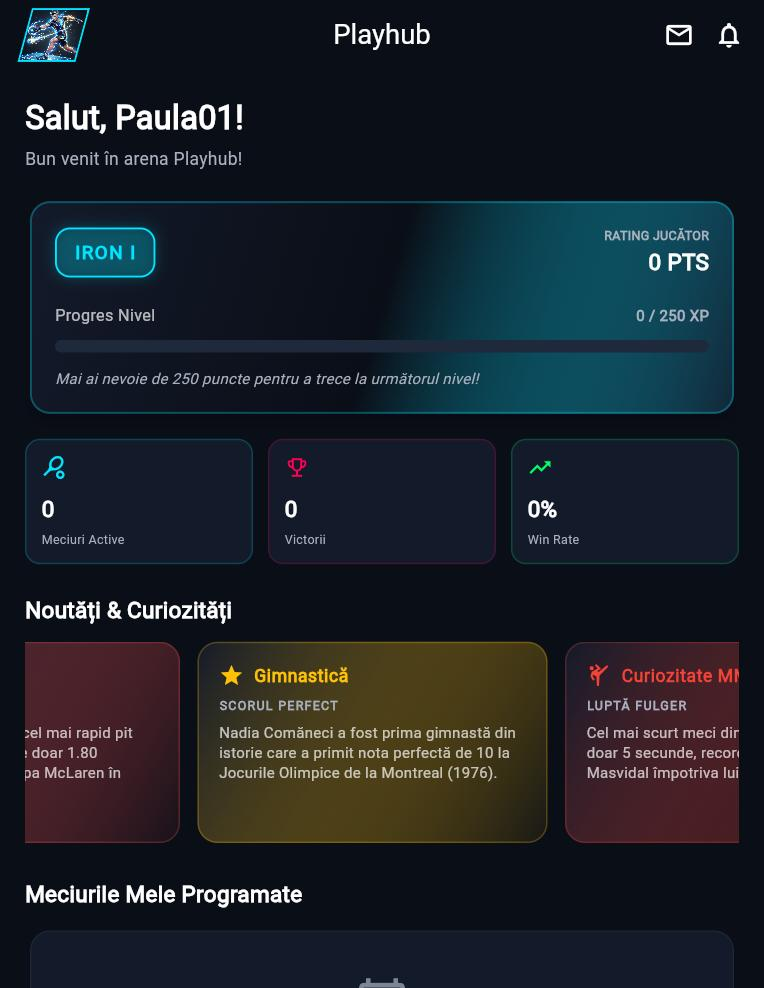
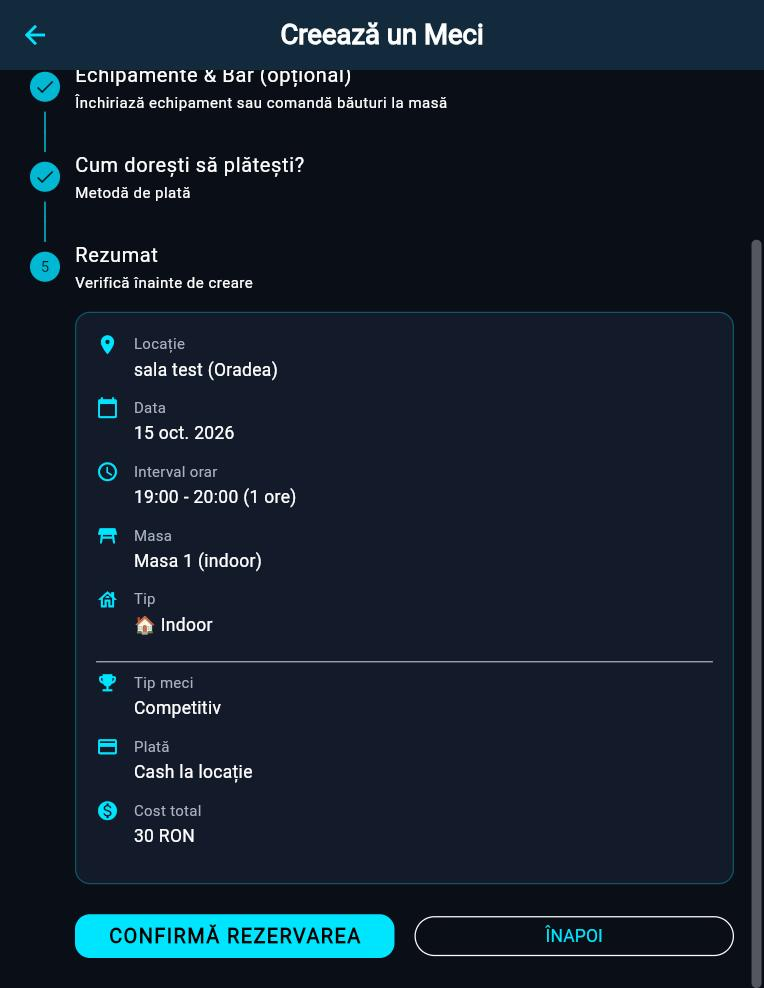
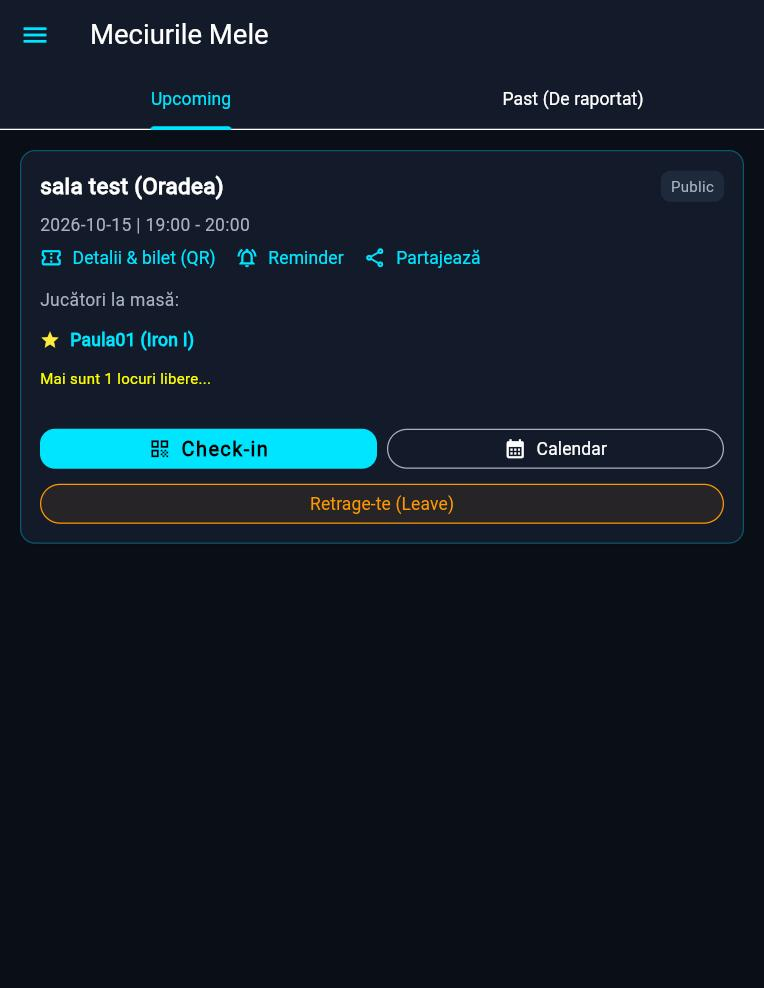

# Playhub

Aplicație mobilă și web pentru **rezervarea sălilor sportive** (ping pong, fotbal și altele) și pentru **găsirea partenerilor de joc**. Jucătorii caută o sală, rezervă o masă sau un teren, plătesc cu cardul sau cash la locație și invită prieteni. Sălile își administrează programul, prețurile, vouchere și încasările din aceeași aplicație.

Proiect personal, construit cu **Flutter** și **Firebase**; plățile merg prin **Stripe**, iar logica sensibilă rulează în **Cloud Functions**.

## Capturi de ecran

<!-- Adaugă imaginile în docs/screenshots/ și șterge marcajele de comentariu de mai jos.

| Panou jucător | Căutare săli | Rezervare | Meciurile mele |
|---|---|---|---|
|  |  |  |  |

| Calendar sală | Prețuri și reduceri | Vouchere | Raport venituri |
|---|---|---|---|
|  |  |  |  |
-->

## Ce poate face

### Jucător
- **Căutare de săli** pe hartă și în listă: filtre după preț pe oră, rating, „deschis acum” și servicii extra; sortare după distanță, preț sau rating.
- **Rezervare** pe masă/teren, cu alegerea sportului și a intervalului (inclusiv jumătăți de oră), plată cu cardul (Stripe) sau cash, rezervări recurente și lista de așteptare când masa e ocupată.
- **Meciuri publice și private**: alți jucători se alătură direct sau cer aprobarea gazdei; chat pe meci; invitarea prietenilor.
- **Link de partajare** pentru un meci: oricine îl deschide vede detaliile și se poate alătura după autentificare.
- **Remindere înainte de meci, setate de jucător**: prima notificare cu 1/2/3 ore, 1/2/3 zile sau 1 săptămână înainte, cu repetare la interval ales (de un număr de ori sau până începe meciul); setări generale și separate pe fiecare meci.
- **Check-in cu QR** sau cod scurt, cu întârzieri și No-Show.
- **Vouchere**: coduri de reducere ale sălilor și un cod de bun venit pentru prima rezervare.
- **Social**: feed, prieteni, clasament, statistici, turnee, recenzii cu poze.
- **Cont**: 5 limbi (română, engleză US/UK, franceză, spaniolă, maghiară), temă luminoasă/întunecată, export de date și ștergere de cont (GDPR).

### Sală
- Înscriere cu abonament lunar (Stripe Billing) și cont de încasare **Stripe Connect**.
- **Calendar** cu mutarea rezervărilor prin drag & drop, cu verificarea conflictelor.
- **Prețuri pe interval**: tarife fixe sau reduceri procentuale pe zile, ore și perioade.
- **Blocare de intervale** și **anulare în masă** cu rambursare automată și notificarea jucătorilor.
- **Vouchere proprii** (procent sau sumă fixă, perioadă, număr maxim de folosiri, o dată per utilizator, sumă minimă).
- **Raport de venituri** pe zi sau pe lună, cu export CSV.
- Plan de mese, servicii extra, inventar bar, istoric rezervări.

### Administrare
Aprobare săli, utilizatori, rapoarte, abonamente și raport de check-in.

## Arhitectură

```mermaid
flowchart LR
  subgraph Client["Flutter (Android, iOS, web)"]
    UI[Ecrane + widgeturi]
    SVC[Servicii: booking, voucher, reminder, share...]
    I18N[tr() - 5 limbi]
  end

  subgraph Firebase
    AUTH[Authentication]
    FS[(Cloud Firestore)]
    RULES{{Reguli de securitate}}
    FCM[Cloud Messaging]
    HOST[Hosting - versiunea web + link-uri de meci]
    subgraph CF["Cloud Functions (Node 20)"]
      PAY[Plăți Stripe + Connect]
      BILL[Abonamente + webhook]
      VOUCH[Vouchere]
      NOTIF[Email + push la notificări]
      REM[Remindere programate - la 5 min]
      WAIT[Listă de așteptare]
      ACC[Export / ștergere cont]
    end
  end

  STRIPE[(Stripe)]
  SMTP[Server SMTP]

  UI --> SVC
  SVC -->|citire / scriere| RULES --> FS
  SVC -->|ID token| CF
  SVC --> AUTH
  FS -->|trigger la document nou| NOTIF
  FS -->|trigger la modificare| WAIT
  REM -->|creează notificări| FS
  NOTIF --> FCM
  NOTIF --> SMTP
  PAY <--> STRIPE
  BILL <--> STRIPE
  FCM --> Client
  HOST --> Client
```

### Cum circulă o notificare
Orice eveniment (rezervare nouă, anulare, cerere de alăturare, reminder) devine un document în `notifications`, salvat cu o **cheie de traducere** și argumente, nu cu text gata scris. Din acel document pornesc trei lucruri: clopoțelul și popup-ul din aplicație, emailul și notificarea push. Fiecare le primește în **limba destinatarului**, compusă din același fișier de traduceri (`functions/i18n.json`) folosit și de aplicație.

### Plăți
- Jucătorul plătește prin Stripe (Payment Intent creat de o funcție, nu de client); suma ajunge la sală printr-un **cont conectat** (destination charge), iar platforma reține un comision fix.
- Abonamentul sălii rulează prin Stripe Billing, cu **webhook** pentru starea abonamentului.
- Cheile Stripe stau în **Secret Manager**, nu în cod.

### Vouchere
Codurile nu pot fi citite de jucători. Se verifică și se consumă doar prin funcții: folosirea se rezervă **atomic într-o tranzacție**, există limită de încercări greșite pe oră, iar o folosire se eliberează dacă plata eșuează.

### Securitate
- Regulile Firestore blochează accesul anonim, escaladarea de privilegii și modificarea plăților de către jucători.
- Funcțiile verifică **Firebase ID token** pe fiecare cerere.
- Ștergerea contului și exportul de date sunt făcute pe server.

## Tehnologii

| Zonă | Alegeri |
|---|---|
| Aplicație | Flutter (Dart 3.9), Material, `flutter_map`, `geolocator`, `fl_chart`, `mobile_scanner` / `qr_flutter`, `share_plus`, `pdf` / `printing` |
| Backend | Firebase Auth, Cloud Firestore, Cloud Messaging, Hosting, Cloud Functions v2 (Node 20) |
| Plăți | Stripe (`flutter_stripe`, Payment Intents, Connect Express, Billing) |
| Email | Nodemailer (SMTP) |
| Limbi | sistem propriu `tr(cheie)`, generat dintr-o singură sursă de traduceri |

## Structura proiectului

```
lib/
  screens/      ecrane (jucător, sală, administrare)
  services/     logica cu acces la Firebase: rezervări, vouchere, remindere, notificări, plăți
  utils/        logică pură, ușor de testat: prețuri, reguli de preț, filtre, remindere
  widgets/      componente reutilizabile
  l10n/         dicționare generate (ro, en, fr, es, hu)
  theme/        culori și teme
functions/      Cloud Functions + teste Node
test/           teste Dart
firestore.rules reguli de securitate
```

## Rulare locală

Cerințe: Flutter, Node 20, Firebase CLI.

```bash
flutter pub get
flutter run                 # sau: flutter run -d chrome
```

Proiectul Firebase este configurat în `lib/firebase_options.dart` (generat cu FlutterFire). Pentru propriul proiect: `flutterfire configure`.

### Backend

```bash
cd functions
npm install
firebase functions:secrets:set STRIPE_SECRET_KEY    # și celelalte secrete folosite de functions/
firebase deploy --only firestore:rules,functions
```

Funcțiile programate (remindere) cer planul **Blaze**.

### Versiunea web și link-urile de meci

```bash
flutter build web
firebase deploy --only hosting
```

Adresa folosită în link-uri se schimbă în `lib/services/share_service.dart` (`baseUrl`).

## Teste

```bash
flutter test            # teste Dart: prețuri, reguli de preț, vouchere, conflicte de rezervări, filtre, remindere
cd functions && npm test   # teste Node: calculul reducerilor, ora și programarea reminderelor
```

Logica importantă este ținută în funcții pure (`lib/utils/`, `VenueTools.moveConflict`, `evaluate` din `functions/vouchers.js`), tocmai ca să poată fi testată fără Firebase.

## Ce urmează
- Mutarea calculului prețului final și a rezervărilor pe server (acum prețul vine din client).
- Deschiderea link-urilor de meci direct în aplicația mobilă (App Links / Universal Links).
- Teste de integrare pe fluxul complet de rezervare.
